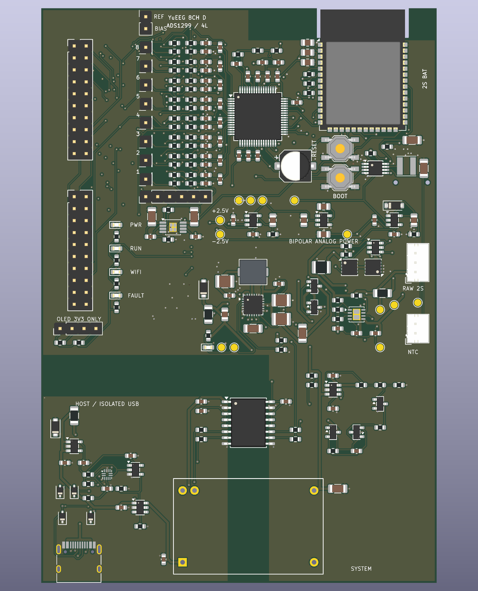

# YuEEG · 八通道湿电极 EEG 工程

当前版本为 **Rev D 工程评审版**：ADS1299 + ESP32-S3-WROOM-1-N16R8，包含 KiCad 9 原理图/PCB、2S 电池管理、隔离 USB、Wi-Fi 数据输出及配套固件。

工程已完成静态检查和固件编译，**尚未完成样机烧录、噪声、充放电故障、并发传输、隔离耐压和漏电流验证**。不应据此将板子视为已获人体使用放行或医疗认证的设备。

## 从这里开始

- [使用指南：硬件、烧录、USB/Wi-Fi 接收](docs/GETTING_STARTED.md)
- [硬件入口与原理图](hardware/README.md)
- [固件配置、命令和二进制帧协议](Firmware/ads1299_driver/README.md)
- [设计取舍与电气复核](hardware/YuEEG_8CH_RevD/REV_D_REVIEW.md)
- [完整评审交付包](hardware/YuEEG_8CH_RevD_84x122_isolated_USB_WiFi_review.zip)
- [项目目录与版本管理](docs/PROJECT_STRUCTURE.md) · [更新记录](CHANGELOG.md)

## Rev D 概况

| 项目 | 当前设计 |
|---|---|
| 采集 | ADS1299，八通道，默认 500 SPS、增益 12，外部公共 REF，独立 BIAS |
| 控制器 | ESP32-S3-WROOM-1-N16R8，双核 240 MHz、16 MB Flash、8 MB PSRAM |
| 供电 | 模拟 ±2.5 V；2S 电池充电、保护和均衡；开机采集、关机充电 |
| Type-C | 经数据与电源隔离支持原生 USB 烧录/CDC；与 Wi-Fi 并行输出 |
| USB 条件 | 默认电流端口需要电池；广告 1.5 A/3 A 的 Type-C 才启用隔离供电 |
| 扩展与显示 | P/N 可旁路模拟前端接口；POWER/RUN/WIFI/FAULT 与充电灯；预留 3.3 V I²C OLED |
| PCB | 84 × 122 mm、四层、332 个元件；13 页原理图 |
| 工艺 | 72 处焊盘内过孔需填孔、铜封帽；详见加工说明 |

电解电容及 RESET/BOOT 按键在正面；CH1–8、REF、BIAS 同列。OLED 尚未装配或提供驱动；扩展放大器也没有默认装配，不能宣称预留接口会自动消除滤波失配。



预览中部分连接器及隔离电源无完整 3D 模型，不能代替机械装配审核。

## 接收数据

在仓库根目录运行。USB 接收需要 Python 3 和 pyserial；UDP 接收与无线控制仅使用 Python 标准库。

```powershell
python -m pip install -r Firmware/tools/requirements.txt
python Firmware/tools/receive_eeg.py --serial COM5 > eeg_usb.csv
```

将 COM5 改为实际设备端口。无线使用方法见使用指南：先通过 USB `status` 保存本机 AP 密码，然后连接设备 Wi-Fi，通过 UDP 9001 认证启停，通过 UDP 9000 接收数据。默认停采，数据帧为二进制格式；旧文本绘图程序不能直接使用。

## 验证状态

冻结的 Rev D 报告中，ERC、DRC、未连接项及原理图/PCB 一致性问题均为零；941 个引脚连接核对通过。N16R8 固件已使用 Arduino ESP32 core 2.0.11 编译，五项协议测试通过。实际设备表现仍需样机验收。

```powershell
python Firmware/tools/test_protocol.py
python scripts/verify_review.py
```

第二条命令检查交付哈希、检查报告关联的 PCB、固件快照和 ZIP 内容，不会重新运行电气检查或编译固件。GitHub Actions 运行这两项离线检查。

## 历史内容与兼容性

`Firmware/Plot/` 为旧文本串口绘图；`Paradigm/` 为历史 SSVEP 范式及平台依赖；`Model/` 为历史外壳和脑电帽。它们保留原路径，尚未适配 Rev D 协议或新板框。旧 Xiao ESP32-S3 接线、供电和文本数据格式只在 [旧版首页](docs/archive/README_legacy_2025.md) 中保留。

Rev A/A1/B/C 评审 ZIP 见 [硬件归档](hardware/archive/README.md)。芯片手册的一手来源见 [资料索引](reference/README.md)。完整编译缓存、资料下载、IDE 状态及临时布线工作文件只保留在本地。

## 许可

沿用原作者的 **MIT License with Restrictions**，包含未经版权所有者许可不得用于商业比赛的附加限制，**不是标准 MIT 许可**。正文从旧首页原样提取至 [LICENSE](LICENSE)，本次未修改授权条款。第三方资料、库和模型依其各自许可使用。
