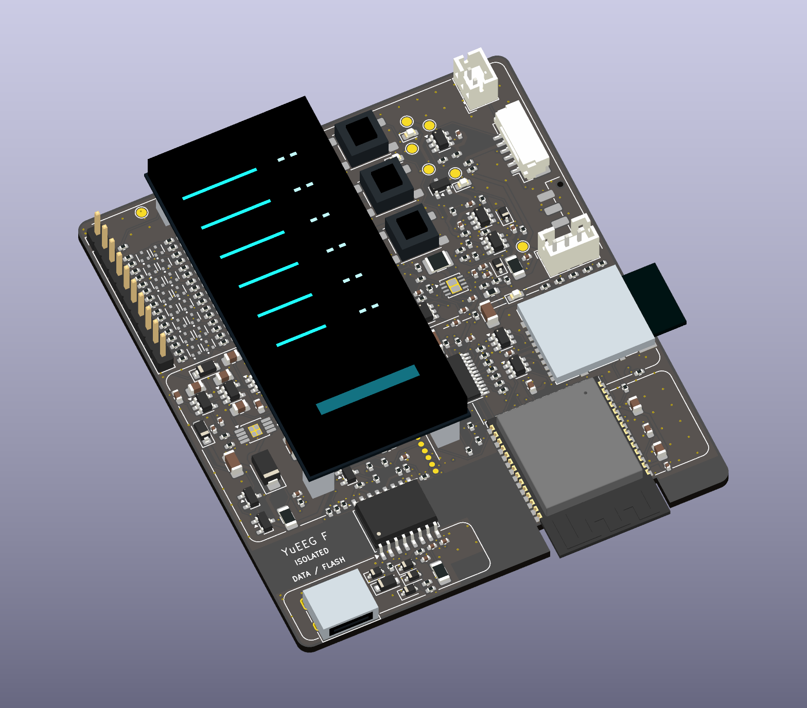

# YuEEG · 八通道湿电极 EEG 工程

当前为 **Rev F 工程评审版**：ADS1299 + ESP32-S3-WROOM-1-N16R8，主板 **70 × 80 mm**、隔离充电副板 **44 × 48 mm**，两板元件均在正面，AMOLED 在主板上方叠装。

支持隔离 USB CDC 与 Wi-Fi UDP 并行、microSD 原始帧备份、状态灯和 RM67162 AMOLED。主板仅由受保护的 2S 电池供电采集，副板提供独立充电 Type-C。**充电前拔下整个电极线束。**

- [使用指南](docs/GETTING_STARTED.md) · [硬件入口](hardware/README.md)
- [固件、命令和协议](Firmware/ads1299_driver/README.md)
- [Rev F 设计与复核](hardware/YuEEG_8CH_RevF/REV_F_REVIEW.md)
- [完整评审包](hardware/YuEEG_8CH_RevF_70x80_main_44x48_power_review.zip)
- [目录说明](docs/PROJECT_STRUCTURE.md) · [更新记录](CHANGELOG.md)

| 项目 | 当前设计 |
|---|---|
| 采集 | ADS1299，8 通道湿电极，默认 500 SPS、增益 12，共享 REF、独立 BIAS |
| 控制器 | ESP32-S3-WROOM-1-N16R8，双核 240 MHz、16 MB Flash、8 MB PSRAM |
| 电源 | 模拟 ±2.5 V；2S 电池保护/均衡在主板，隔离充电在副板 |
| Type-C | 主板 DATA/FLASH 隔离数据；副板 CHARGE 无数据，不给采集电路供电 |
| 显示 | DWO DO0200PFS12 RM67162 QSPI，8 mm 绝缘支柱叠装 |
| 存储 | SDMMC 1-bit microSD，128 KiB 缓冲，50 字节带 CRC 原始帧 |
| 装配 | 普通 PTS645 SMT 按键、电解电容在正面；两板背面无贴片器件 |
| PCB | 主板 305 封装 / 16 页；副板 50 封装 / 4 页，均为四层 |



屏幕图案为示意。PCB 面积不等于整机体积，电池和外壳尚未选定。定制屏幕线束、通孔装配和焊盘内过孔填孔封帽要求见交付包。两板静态 ERC/DRC/未连接/原理图一致性均为零，固件已编译且 6 项主机协议测试通过；实物噪声、并发、充电、温升和隔离验证尚未完成，不能视为已获人体使用放行。

```powershell
python Firmware/tools/test_protocol.py
python scripts/verify_review.py
```

Rev D、Rev E 保持冻结，可从 [历史索引](hardware/archive/README.md) 回溯。项目许可为仓库中的 [MIT License with Restrictions](LICENSE)，不是不附加限制的标准 MIT。
