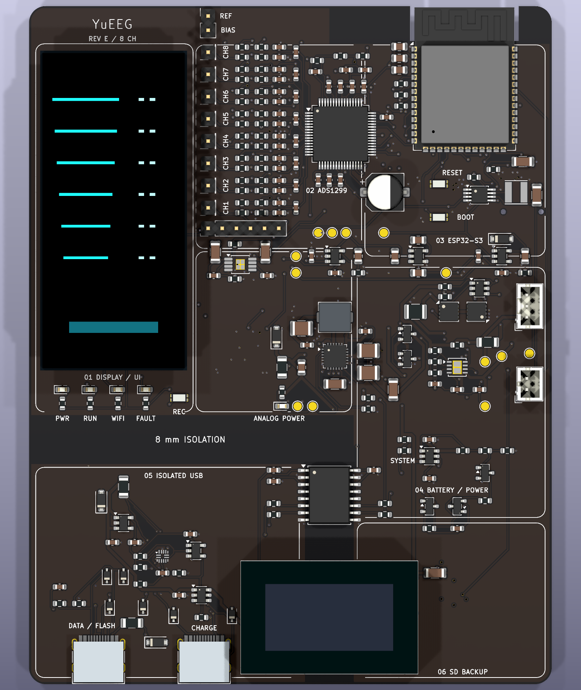

# YuEEG · 八通道湿电极 EEG 工程

当前版本为 **Rev E 工程评审版**：ADS1299 + ESP32-S3-WROOM-1-N16R8，双 Type-C、隔离 USB、Wi-Fi UDP、AMOLED 与 microSD 备份。

工程已完成静态检查和固件编译，尚未完成样机烧录、显示/存储联调、噪声、充放电故障、并发传输、隔离耐压和漏电流验证。不能据此视为已获人体使用放行或医疗认证的设备。

## 从这里开始

- [使用指南](docs/GETTING_STARTED.md) · [硬件入口](hardware/README.md)
- [固件、命令和帧协议](Firmware/ads1299_driver/README.md)
- [Rev E 设计分析与电气复核](hardware/YuEEG_8CH_RevE/REV_E_REVIEW.md)
- [完整评审交付包](hardware/YuEEG_8CH_RevE_94x122_dual_USB_AMOLED_SD_review.zip)
- [目录与版本管理](docs/PROJECT_STRUCTURE.md) · [更新记录](CHANGELOG.md)

| 项目 | 当前设计 |
|---|---|
| 采集 | ADS1299，八通道湿电极，默认 500 SPS、增益 12，外部公共 REF，独立 BIAS |
| 控制器 | ESP32-S3-WROOM-1-N16R8，双核 240 MHz、16 MB Flash、8 MB PSRAM |
| 电源 | 模拟 ±2.5 V；2S 电池充电、保护和均衡；开机采集、关机充电 |
| 双 Type-C | DATA/FLASH 隔离烧录/CDC；CHARGE/POWER 独立充电/供电；VBUS 不并联 |
| USB 供电条件 | DATA 单独使用需电池；CHARGE 源广告 1.5 A/3 A 才启用隔离供电 |
| 显示 | DWO DO0200PFS12 RM67162，1.91 英寸 240 × 536 AMOLED，独立电源/电平转换 |
| 备份 | SDMMC 1-bit microSD，128 KiB 缓冲，保存带 CRC 的 .yee 原始帧，可离线转 CSV |
| 按键/外观 | 正面 0.53 mm RESET/BOOT/REC、分组状态灯、圆角丝印分区、黑色阻焊白字 |
| PCB | 94 × 122 mm、四层、378 个元件；15 页原理图 |

CH1–8、REF、BIAS 保持同列，电解电容和按钮在正面。外置模拟前端扩展接口已移除。板宽为显示模块及绝缘支撑结构增加 10 mm；Rev D 的 84 × 122 mm 文件保持冻结。



屏幕图案为布局示意。新增原始包络模型用于外观检查，实际模块、18 芯排线、插卡方向和外壳配合仍需首板复核。

## 数据与验证

```powershell
python Firmware/tools/receive_eeg.py --serial COM5 > eeg_usb.csv
python Firmware/tools/receive_eeg.py --udp 9000 > eeg_wifi.csv
python Firmware/tools/receive_eeg.py --file eeg_000001.yee > eeg_sd.csv
python Firmware/tools/test_protocol.py
python scripts/verify_review.py
```

USB 接收需 pyserial；UDP 和离线转换仅使用 Python 标准库。默认停采，可用 REC 或认证命令启停；AP 密码通过 USB `status` 获取。详见固件说明。

Rev E 的 ERC、DRC、未连接及原理图/PCB 一致性问题均为零；1068 个引脚连接复核通过。N16R8 固件已使用 Arduino ESP32 core 2.0.11 编译，六项协议测试通过。交付检查脚本核对文件哈希、报告绑定、固件快照和 ZIP，同时核对 Rev D 冻结包；不会重新运行 KiCad 或进行物理测试。

## 历史与许可

`Firmware/Plot/` 是旧文本串口绘图，`Paradigm/` 是历史 SSVEP 范式，`Model/` 是历史外壳和脑电帽，尚未适配新帧协议或板框。[旧首页](docs/archive/README_legacy_2025.md) 保留历史接线；[硬件归档](hardware/archive/README.md) 保留旧版本。资料来源见 [reference 索引](reference/README.md)。编译缓存、下载手册和布线临时文件只留在本地。

沿用原作者的 **MIT License with Restrictions**，含商业比赛附加限制，不是标准 MIT 许可。正文见 [LICENSE](LICENSE)，本次未修改条款。第三方资料和库遵循各自许可。
