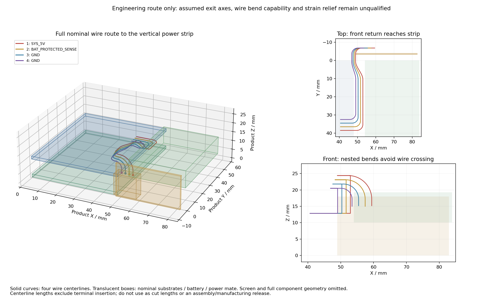

# 电源条板完整线束路径复核

2026-11-01。此前线束图只从数字板走到主板 Y=0。本次将四根线继续接到竖置电源条板 JP2 的四个对应位置，并完成三维路径、线间距离与选定障碍物筛查。**没有修改 PCB，也未将实物线束或整机装配放行。**

## 基准和接线

产品坐标采用模拟板正面 Z=0；数字板背面 Z=8.5 mm、正面 Z=10.1 mm。数字板厚度从原生 PCB 读取。电源条板竖置，其原生坐标映射为 `X=48.95+PCB_X`、`Y=-4.05-PCB局部Z`、`Z=18-PCB_Y`。电池仍在右侧 X=54…83.9、Y=0…42.7、Z=10.1…19.3 mm 的名义包络内。

两端原生 PCB 提取针号保持一致：1=SYS_5V，2=BAT_PROTECTED_SENSE，3／4=GND。电源板 JP2 仍为 (7.5,11)、180°；数字板 JH2 仍为 (32.4,38.5)、90°。

[JST PH 公开目录](https://www.jst-mfg.com/product/pdf/eng/ePH.pdf)第 2／4 页给出 SMT 侧入针座中央本体长 6 mm、配对参考长度 9.6 mm。结合原生封装中央本体后缘局部 Y=-1.6，得到一个名义插头出口局部 Y=8.0，对应竖板产品 Z=15.0 mm。该推导是参考装配模型，不是有公差的厂家出线基准。胶壳出线轴距安装面 2.75 mm 仍为假设。

## 完整路径的结果

四根线先在右侧通道内上升，再在屏幕投影外逐渐偏移，最后经过不同高度的转弯接入朝上的电源插头。末端分别预留 2.2 mm 自由直线段；这只是设计提案，不等于已核定应力释放或厂家规定的最小直线长度。

| 线号 | 连接 | 外部中心线路径长度 |
| --- | --- | --- |
| 1 | SYS_5V，1→1 | 76.35 mm |
| 2 | 电池检测，2→2 | 70.02 mm |
| 3 | GND，3→3 | 63.79 mm |
| 4 | GND，4→4 | 57.66 mm |

以上长度不包含端子内部插入、剥线及装配余量，**不能直接作为裁线长度**。

按线外径最大 1.1 mm、中心线转弯半径不小于 3.3 mm 的条件，解析路径采样步长不超过 0.02 mm。距离结果另扣采样上界，得到：

- 线间管体间隙下界约 0.18 mm；仍没有计入排线固定误差。
- 对名义电池包络的管体间隙下界约 0.49 mm。
- 对数字板／电源条板**基材**的管体间隙下界约 2.19 mm；不代表板上所有元件已检查。
- 对当前自制屏幕延长 FPC 模型的管体间隙下界约 9.69 mm；不包含原屏背面排线。
- 对三处假设直径 4 mm、贯穿任意高度的固定件圆柱，最小 XY 管体间隙下界约 0.78 mm；未核定具体固定件。

这条路径的最高管体到 **Z=24.95 mm**，明显高于电池名义顶部 Z=19.3 mm。电源条板配对插头参考包络向产品前方到 Y=-9.55 mm。由此可见，朝上出线会增加高度，不能再单凭 34×18 mm 条板尺寸认为整机已经很薄。

## 仍未完成的设计条件

当前线材未选到具有可核实静态弯曲半径与外径上限的具体料号；3.3 mm 不能作为通用线材能力。JST 端子必须匹配导体和绝缘外径，并确认压接工具／工艺。原厂独立 CAD 下载入口要求提供联系资料和同意其条款，本项目本次仅使用无需提交资料的公开目录，没有代用户提交个人信息或接受条款。

仍需补入真实胶壳轴线及公差、全部元件、原屏背面结构、固定／应力释放、电池仓止挡、外壳和整机绝缘系统。噪声、回路面积、压降与并发采集需要样机验证。本报告提供了可复现的完整名义路线和高度代价，不能替代最终线束图纸、裁线表或制造放行。

下一步应优先评估电源条板插座转向，使线束从侧面接入，并在完成实际 PCB 扇出和空间检查后决定是否采用；不能只旋转示意模型就认为电路板已改好。
