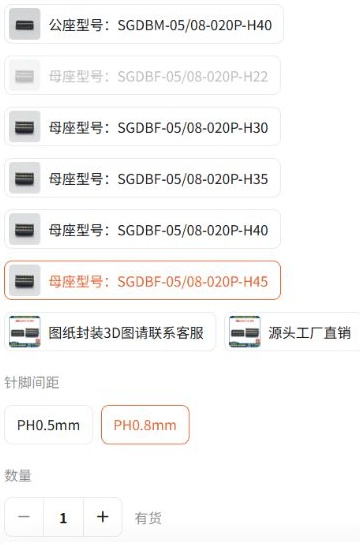

# Rev H 板间连接器采购图纸复核

2026-11-01。已在用户登录的 Codex 内置浏览器中核实一组淘宝贴片 BTB 公母座，并取得商品附带的完整两页厂家尺寸图。已按 SGDCONN 图纸更新正式 PCB、BOM 和原生封装，完成局部布线及检查。

## 已核实的淘宝组合

店铺：深圳市山谷道科技有限公司，品牌 SGDCONN。商品 [860586965302](https://item.taobao.com/item.htm?id=860586965302)。

| 安装位置 | 具体规格与选项 | 商品 SKU |
| --- | --- | --- |
| 数字板背面公座 | SGDBM-08-020P-H40；选择“公座 H40”及“PH0.8mm” | [5677537797627](https://item.taobao.com/item.htm?id=860586965302&skuId=5677537797627) |
| 模拟板正面母座 | SGDBF-08-020P-H45；选择“母座 H45”及“PH0.8mm” | [5677537797637](https://item.taobao.com/item.htm?id=860586965302&skuId=5677537797637) |

两组具体选项均已在页面选中并显示“有货”；这是当日页面观察，不是后续库存保证。商品标题混写 05/08，必须同时选择 PH0.8mm。未下单或联系卖家。

商品附带 [0.8 双槽公母座图纸](https://itemcdn.tmall.com/attachment/icoss234754281bbb74bf255ec8c29)，共两页，图号 SGD-003／SGD-004，Rev A，原日期 2014-08-30，2026-07-01 修改定位孔由 0.7 到 0.65 mm。原始 PDF 仅本地读取，校验散列、事实摘录与无账号页头的选项截图记录在 `review/sgd_btb_procurement.json`。

20 针对应：0.8 mm 间距、4.0 mm 两排中心距、9.0 mm 定位孔距、孔心偏置 1.25 mm；推荐焊盘 **0.30×2.00 mm**，外跨 6.00 mm；孔径 **0.65 +0.03/-0 mm**，塑胶柱径 0.60 mm。H40 公座与 H45 母座的名义合高 **8.5 mm**。这组图的定位孔跨度为 C=9.0 mm，与下方 JME 2021 版 C=8.2 mm 的情况不同。

新图未直接给出组合 H 的 ±0.15 mm 公差，不能沿用旧 JME 图的该数值；8.3 mm 最小局部实测板间隙仍是装配验收条件。图纸给出 0.5 A／50 V，商品参数中 60 V 不能覆盖图纸值。公母 PCB 图在相反端标 PIN1／PIN2；本项目继续采用明确的逻辑编号，必须依实际对插坐标核查 20 路网络，不能把项目编号直接称为厂家完整针序。

新焊盘比旧封装加长 0.2 mm，已调整模拟板4个、数字板8个过孔及局部扇出，完成包含同网络焊盘的孔到铜检查。当前正式板 ERC／DRC／未连接／原理图一致性均为零，工程 Gerber 已重导出；完整机械装配及制造资格尚未放行。

## 此前 JME 目录资料（未采用）

| 商品条目 | 所附厂家资料 | 当前结论 |
| --- | --- | --- |
| [5001-BTB0840-20MR-00，C48688647](https://www.lcsc.com/datasheet/C48688647.pdf) | 2021-07-08，Rev1.0，公／母座共两页 | 有完整商品料号和厂家图；不是当前封装已核定的直接替代件 |
| [5001-BTB0845-20FR-00-B，C53277662](https://jlcpcb.com/partdetail/JMEconn-5001_BTB0845_20FR_00B/C53277662) | 2021-07-08，Rev1.0，公／母座共两页 | 同样需要核对定位柱及焊盘版本 |

两份资料均包含公座 G8BTC0004、母座 G8BTC0003 的图，须查看两页，不能因第一页为公座就认定母座商品挂错文件。两份 PDF 的校验散列及直链记录在 `review/smt_btb_procurement_revision_review.json`。商品条目不等于即时库存、淘宝货源或到货尺寸已经确认。

## 历史 JME 图纸差异

| 维度 | 历史封装依据：2017 Rev B | 新查到的 2021 Rev1.0 图 |
| --- | --- | --- |
| 20 针触点间距、两排中心距 | 0.8 mm、4.0 mm | 0.8 mm、4.0 mm |
| 4.0 mm 公座＋4.5 mm 母座合高 | 8.5 mm | 8.5 mm |
| 推荐贴片焊盘 | 0.35×1.80 mm | 0.30×2.00 mm |
| 焊盘两排总外跨 | 5.80 mm | 6.00 mm |
| 定位孔跨度标注 | PCB 图标 D，20 针表 D=9.0 mm | PCB 图标 C，20 针表 C=8.2 mm |

按 2021 图中 `PCB LAYOUT` 的 C 标注解释定位孔跨度，会使每侧孔心相对旧 2017 封装移动 **0.4 mm**，远大于现有 0.65 mm 定位孔可吸收的偏差。不能只因料号前缀、针数和合高相同就混装。

进一步按该 C 标注及所列 0.30×2.00 mm 矩形焊盘计算，0.65 mm 定位孔到最近焊盘铜边的名义最小距离约 **0.025 mm**；历史 2017 封装的同一计算为 **0.400 mm**。前者低于本板采用的 0.25 mm 孔到铜约束。因此还需要核实厂家图的 C／D 标注、实际定位柱版本和可制造的推荐图，不能把这份图未经复核直接替换进 PCB。该计算仅比较名义圆孔与矩形焊盘，不包含孔径、孔位与器件公差。

## 已完成适配与剩余验收

淘宝具体组合及两页配套尺寸图已找到。SGDCONN 封装、局部扇出、20 路逻辑映射、孔到铜、ERC／DRC／网表和制造导出已更新；到货后还需进行尺寸、插合、焊接及局部板间隙验收。

当前原生检查对应 SGDCONN 封装，不能混装旧 JME 或其他同类件。当前工程 Gerber 的未放行状态保持。

加工能力追加复核：嘉立创公开常规NPTH公差为±0.10mm，不能直接满足所选SGD定位孔的0.65+0.03/-0mm。两板各两个定位孔须由板厂单独接受成品公差；当前不按默认工艺下单，也未未经复核扩大孔径。见[加工公差记录](REVH_POGO_HOLE_TOLERANCE.md)。
