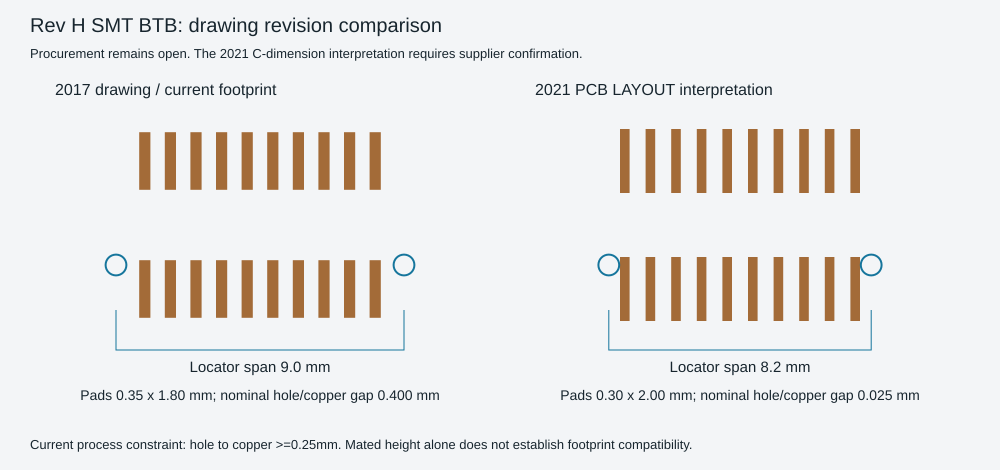

# Rev H 板间连接器采购图纸复核

2026-11-01。当前 PCB 仍使用已检查的 2017 版贴片 BTB 封装；本次未改动铜箔，也未把后来查到的完整商品料号写成可直接下单替代件。

## 新找到的具体商品资料

| 商品条目 | 所附厂家资料 | 当前结论 |
| --- | --- | --- |
| [5001-BTB0840-20MR-00，C48688647](https://www.lcsc.com/datasheet/C48688647.pdf) | 2021-07-08，Rev1.0，公／母座共两页 | 有完整商品料号和厂家图；不是当前封装已核定的直接替代件 |
| [5001-BTB0845-20FR-00-B，C53277662](https://jlcpcb.com/partdetail/JMEconn-5001_BTB0845_20FR_00B/C53277662) | 2021-07-08，Rev1.0，公／母座共两页 | 同样需要核对定位柱及焊盘版本 |

两份资料均包含公座 G8BTC0004、母座 G8BTC0003 的图，须查看两页，不能因第一页为公座就认定母座商品挂错文件。两份 PDF 的校验散列及直链记录在 `review/smt_btb_procurement_revision_review.json`。商品条目不等于即时库存、淘宝货源或到货尺寸已经确认。

## 与当前 PCB 的具体差异

| 维度 | 当前封装依据：2017 Rev B | 新查到的 2021 Rev1.0 图 |
| --- | --- | --- |
| 20 针触点间距、两排中心距 | 0.8 mm、4.0 mm | 0.8 mm、4.0 mm |
| 4.0 mm 公座＋4.5 mm 母座合高 | 8.5 mm | 8.5 mm |
| 推荐贴片焊盘 | 0.35×1.80 mm | 0.30×2.00 mm |
| 焊盘两排总外跨 | 5.80 mm | 6.00 mm |
| 定位孔跨度标注 | PCB 图标 D，20 针表 D=9.0 mm | PCB 图标 C，20 针表 C=8.2 mm |

按 2021 图中 `PCB LAYOUT` 的 C 标注解释定位孔跨度，会使每侧孔心相对当前板移动 **0.4 mm**，远大于现有 0.65 mm 定位孔可吸收的偏差。不能只因料号前缀、针数和合高相同就混装。

进一步按该 C 标注及所列 0.30×2.00 mm 矩形焊盘计算，0.65 mm 定位孔到最近焊盘铜边的名义最小距离约 **0.025 mm**；当前 2017 封装的同一计算为 **0.400 mm**。前者低于本板采用的 0.25 mm 孔到铜约束。因此还需要核实厂家图的 C／D 标注、实际定位柱版本和可制造的推荐图，不能把这份图未经复核直接替换进 PCB。该计算仅比较名义圆孔与矩形焊盘，不包含孔径、孔位与器件公差。

## 选型继续执行的条件

用户要求由项目自行寻找**淘宝上有详细尺寸图**的贴片公母配对件。需要在同一商品／明确配套组合中核对：20 针、8.5 mm 合高、公母各自高度、定位柱直径和中心距、推荐焊盘与可选的定位柱版本。再按最终商品图调整封装、原生检查及制造导出。

在取得这些依据前，当前原生 ERC／DRC 为零仍只证明现有设计与其 2017 封装库一致，不能证明后来商品或任意淘宝同类件可直接装配。当前工程 Gerber 的未放行状态保持。
