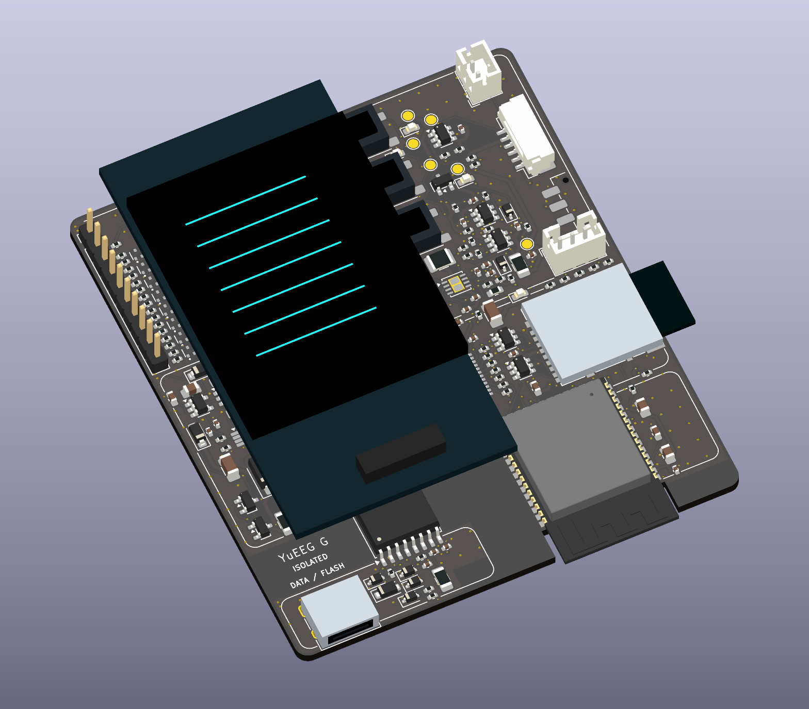

# YuEEG Rev G — AM178 AMOLED 适配评审版

Rev G 使用鱼鹰光电 OSPTEK **AM178Q368448LK / CO5300，368 × 448**。基于用户提供的完整厂商资料制作独立屏幕载板，保留 Rev F 主板全部走线、过孔、焊盘及采集/充电电路；不缩减 USB 数据隔离。主板仅电池供电，充电前拔掉整个电极线束。

| PCB | 尺寸 | 铜层 | 封装数 | 当前状态 |
|---|---|---|---|---|
| [主板](YuEEG_8CH_RevG.kicad_pro) | 70 × 80 mm | 4 | 305 | Rev G，电路与 Rev F 相同 |
| [屏幕载板](display_carrier/YuEEG_DISPLAY_G.kicad_pro) | 35 × 67 mm | 2 | 15，含 4 安装孔 | 新增，顶面装配 |
| [隔离充电副板](isolated_power/YuEEG_8CH_RevF_POWER.kicad_pro) | 44 × 48 mm | 4 | 50 | 沿用冻结 Rev F，文件未改 |

主板和载板 ERC、DRC、未连接、原理图一致性均为 0；网表分别核对 848 / 55 个连接引脚。隔离副板沿用原 Rev F 静态报告。固件编译占用 769,941 字节，静态 RAM 46,068 字节，6 项主机协议测试通过。尚未进行实物点亮、装配、噪声和隔离测试。

- [屏幕接线、采购与装配复核](DISPLAY_INTEGRATION.md)
- [主板装配工艺](fabrication_review/ASSEMBLY_NOTES.md)、[屏幕载板工艺](display_carrier/fabrication_review/ASSEMBLY_NOTES.md)
- [主板原理图](YuEEG_8CH_RevG.pdf)、[载板原理图](display_carrier/YuEEG_DISPLAY_G.pdf)
- `order_gerbers/` 内三个 ZIP 分别上传，不能合成一块板下单。
- `firmware/` 为本版编译对应快照及二进制；`CHECKSUMS.json` 绑定交付字节。

模型仅表示外形和安装空间，不代表实物装配验证。原模拟、电池、隔离设计的限制继续适用，见 [Rev F 基线记录](reference/REV_F_BASELINE_REVIEW.md)。已有 Rev F 主板可配新载板、10 mm 支柱和 Rev G 固件验证；Rev G 固件不适配旧 RM67162 屏。
