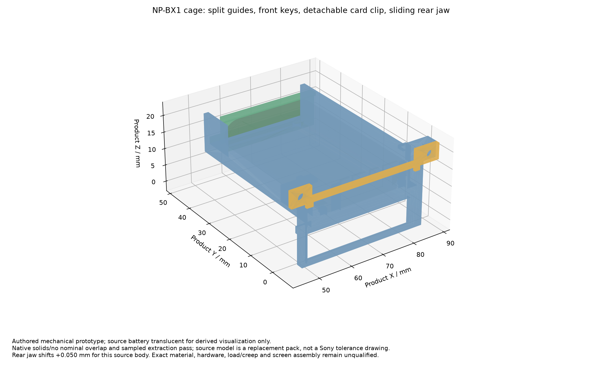

# NP-BX1 电池座机械样件

本目录为三个自设计零件的毫米制 STEP／STL 与条件装配检查点，**不是量产放行文件，也不是完整外壳**。只包含自设计座体；原始电池 STEP／JPG 不发布，装配 STEP 不含电池或厂家紧固件 CAD。

| 文件 | 用途 |
| --- | --- |
| `cradle.step`／`.stl` | 承托底座、分段导向、防呆键与电源条板背托 |
| `power_clip.step`／`.stl` | 电源条板可拆压条 |
| `rear_jaw.step`／`.stl` | 可调后挡块，单件文件为零位 |
| `cradle_assembly.step` | 三件组装，后挡块按用户替代电池模型移至 +0.050 mm |
| `native_cad_review.json` | 实体、装拆、防呆、紧固件与 STEP 回读结果 |
| `power_component_envelopes.json` | 全部 21 个电源封装的原生庭院及条件高度预算 |
| `clearance_review.json` | PCB、条件插头／屏幕包络、紧固件与四线线束间距 |
| `MANIFEST.json` | 本目录与参数／脚本输入绑定 |

STL 不携带单位，导入必须选择 **mm**。三个单件保留共同产品坐标，打印软件可分别平移／旋转；加工方向、支撑、材料、孔径补偿、力学性能及尺寸能力尚未定型。

尺寸、固定件、安装顺序与接收条件见[机械说明](../../../../../docs/REVH_BATTERY_CRADLE.md)。主三板与探针位置保持原设计；当前机械样件仍需实际 Sony 电池、探针、线束、屏幕及壳体装配验证。

